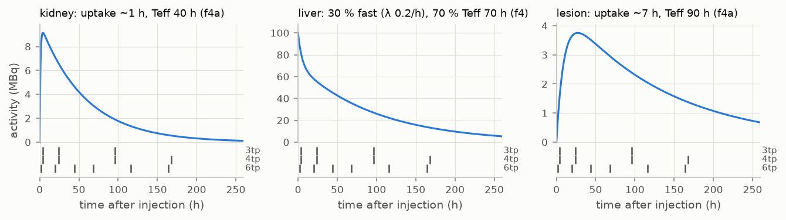
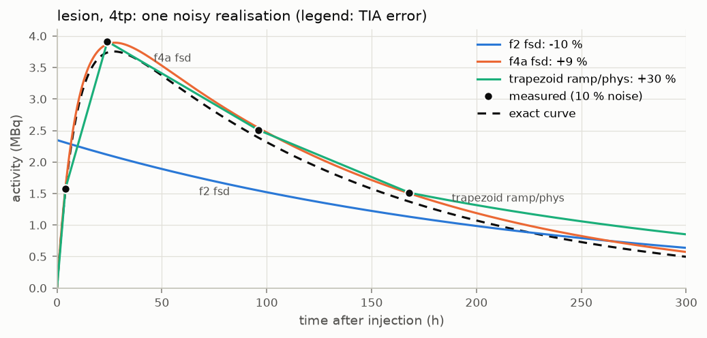
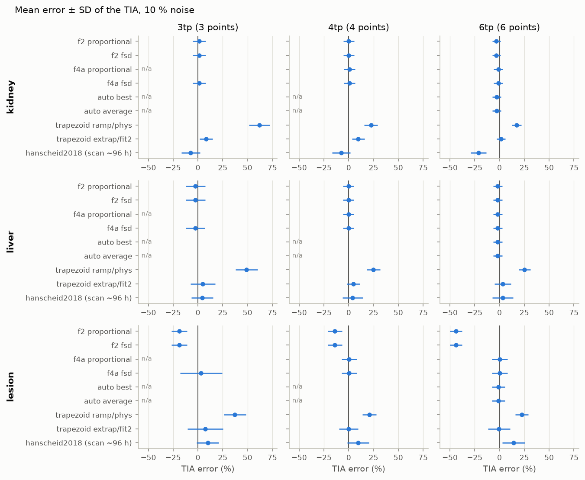
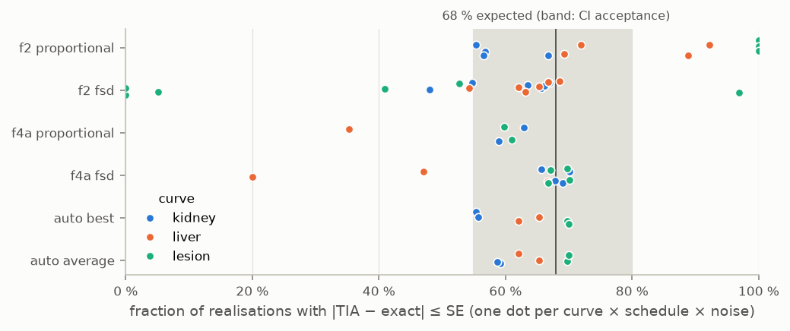

<!-- Generated by validation/integrate/report.py. Do not edit by hand. -->

# Validation of the time integration (synthetic curves)

`radot integrate` (see [time integration](6e_time_integration.md)) on synthetic ¹⁷⁷Lu time-activity curves whose integral is known exactly. Each curve is sampled at the times of an acquisition schedule, with a proportional Gaussian noise; every method sees the same noisy realisations (1000 per configuration). Code and data: [validation/integrate](https://github.com/dsarrut/radot/tree/main/validation/integrate).

## Curves, schedules, methods

| Curve | Model | Parameters (MBq, 1/h) | Shape | Exact TIA (MBq·h) |
|---|---|---|---|--:|
| kidney | `f4a` | 10, 0.01298, 0.9902 | uptake ~1 h, Teff 40 h (f4a) | 567.0 |
| liver | `f4` | 30, 70, 0.2, 0.005557 | 30 % fast (λ 0.2/h), 70 % Teff 70 h (f4) | 7216.0 |
| lesion | `f4a` | 5, 0.003357, 0.09902 | uptake ~7 h, Teff 90 h (f4a) | 600.8 |

| Schedule | Times (h) |
|---|---|
| 3tp | 4, 24, 96 |
| 4tp | 4, 24, 96, 168 |
| 6tp | 2, 20, 44, 68, 116, 164 |

Noise: fractional standard deviation 5 % and 10 % of each point.

| Method | `radot integrate` options |
|---|---|
| f2 proportional | `--model f2` `--error-model proportional` |
| f2 fsd | `--model f2` `--error-model fsd:<noise>` (the true noise level) |
| f4a proportional | `--model f4a` `--error-model proportional` |
| f4a fsd | `--model f4a` `--error-model fsd:<noise>` (the true noise level) |
| auto best | `--model auto` `--candidates f2,f4a` `--select best` `--error-model fsd:<noise>` (the true noise level) |
| auto average | `--model auto` `--candidates f2,f4a` `--select average` `--error-model fsd:<noise>` (the true noise level) |
| trapezoid ramp/phys | `--model trapezoid` `--head ramp` `--tail phys` |
| trapezoid extrap/fit2 | `--model trapezoid` `--head extrap` `--tail fit` `--tail-points 2` |
| hanscheid2018 (scan ~96 h) | one image, the scan closest to 96 h, `--model hanscheid2018` (Teff = 2t) |

The example above: `f2` has no uptake and misses the activity before the first scan; the trapezoid joins the points with straight lines and decays physically after the last one.

n/a: the method cannot run on this schedule (number of points, Kletting 2013 Table I: fit J ≤ N, AICc J + 2 ≤ N, with J = K + 1 when the noise level is estimated).

## Without noise

Error of the TIA (%) on the exact points: the error of the model itself, for this sampling.

**kidney**

| Method | 3tp | 4tp | 6tp |
|---|--:|--:|--:|
| f2 proportional | +1.35 | +1.12 | -1.74 |
| f2 fsd | +1.35 | +1.12 | -1.74 |
| f4a proportional | n/a | +1.12 | +0.00 |
| f4a fsd | +1.35 | +1.12 | +0.00 |
| auto best | n/a | n/a | -1.74 |
| auto average | n/a | n/a | -1.56 |
| trapezoid ramp/phys | +61.80 | +22.47 | +17.58 |
| trapezoid extrap/fit2 | +7.62 | +9.36 | +1.33 |
| hanscheid2018 (scan ~96 h) | -7.44 | -7.44 | -20.92 |

**liver**

| Method | 3tp | 4tp | 6tp |
|---|--:|--:|--:|
| f2 proportional | -3.68 | +0.31 | -0.76 |
| f2 fsd | -3.68 | +0.31 | -0.76 |
| f4a proportional | n/a | +0.31 | -0.76 |
| f4a fsd | -3.68 | +0.31 | -0.76 |
| auto best | n/a | n/a | -0.76 |
| auto average | n/a | n/a | -0.76 |
| trapezoid ramp/phys | +48.51 | +24.63 | +25.36 |
| trapezoid extrap/fit2 | +2.27 | +3.29 | +1.95 |
| hanscheid2018 (scan ~96 h) | +3.86 | +3.86 | +2.95 |

**lesion**

| Method | 3tp | 4tp | 6tp |
|---|--:|--:|--:|
| f2 proportional | -18.21 | -13.15 | -43.72 |
| f2 fsd | -18.21 | -13.15 | -43.72 |
| f4a proportional | n/a | -0.00 | +0.00 |
| f4a fsd | +0.00 | -0.00 | -0.00 |
| auto best | n/a | n/a | -0.00 |
| auto average | n/a | n/a | -0.00 |
| trapezoid ramp/phys | +37.42 | +21.03 | +22.09 |
| trapezoid extrap/fit2 | +10.19 | -1.43 | -1.39 |
| hanscheid2018 (scan ~96 h) | +10.04 | +10.04 | +13.99 |

## With noise

Relative error of the TIA (%): mean ± standard deviation over the realisations.

**kidney**

| Method | 3tp 5 % | 3tp 10 % | 4tp 5 % | 4tp 10 % | 6tp 5 % | 6tp 10 % |
|---|--:|--:|--:|--:|--:|--:|
| f2 proportional | +1.3 ± 3.2 | +1.2 ± 6.5 | +1.0 ± 2.6 | +0.1 ± 5.6 | -2.0 ± 2.1 | -3.2 ± 4.3 |
| f2 fsd | +1.3 ± 3.2 | +1.2 ± 6.5 | +1.0 ± 2.6 | +0.1 ± 5.6 | -2.0 ± 2.1 | -3.2 ± 4.3 |
| f4a proportional | n/a | n/a | +1.0 ± 2.6 | +0.7 ± 5.5 | -0.4 ± 2.3 | -1.3 ± 4.6 |
| f4a fsd | +1.1 ± 3.2 | +1.2 ± 6.4 | +1.0 ± 2.6 | +0.7 ± 5.5 | -0.4 ± 2.3 | -1.3 ± 4.6 |
| auto best | n/a | n/a | n/a | n/a | -1.3 ± 2.4 | -2.9 ± 4.4 |
| auto average | n/a | n/a | n/a | n/a | -1.2 ± 2.3 | -2.8 ± 4.3 |
| trapezoid ramp/phys | +61.9 ± 5.3 | +62.0 ± 10.6 | +22.6 ± 3.5 | +22.5 ± 6.8 | +17.6 ± 2.5 | +17.3 ± 4.9 |
| trapezoid extrap/fit2 | +7.8 ± 3.2 | +8.2 ± 6.4 | +9.5 ± 3.2 | +9.6 ± 6.3 | +1.4 ± 2.2 | +1.4 ± 4.4 |
| hanscheid2018 (scan ~96 h) | -7.5 ± 4.7 | -7.4 ± 9.4 | -7.4 ± 4.5 | -7.4 ± 9.2 | -21.1 ± 4.1 | -21.1 ± 7.9 |

**liver**

| Method | 3tp 5 % | 3tp 10 % | 4tp 5 % | 4tp 10 % | 6tp 5 % | 6tp 10 % |
|---|--:|--:|--:|--:|--:|--:|
| f2 proportional | -3.5 ± 4.4 | -2.5 ± 9.6 | +0.1 ± 2.6 | -0.3 ± 5.5 | -0.9 ± 2.2 | -1.9 ± 4.7 |
| f2 fsd | -3.5 ± 4.4 | -2.5 ± 9.6 | +0.1 ± 2.6 | -0.3 ± 5.5 | -0.9 ± 2.2 | -1.9 ± 4.7 |
| f4a proportional | n/a | n/a | +0.1 ± 2.6 | -0.3 ± 5.5 | -0.9 ± 2.2 | -1.9 ± 4.7 |
| f4a fsd | -3.5 ± 4.4 | -2.7 ± 9.6 | +0.1 ± 2.6 | -0.3 ± 5.5 | -0.9 ± 2.2 | -1.9 ± 4.7 |
| auto best | n/a | n/a | n/a | n/a | -0.9 ± 2.2 | -1.9 ± 4.7 |
| auto average | n/a | n/a | n/a | n/a | -0.9 ± 2.2 | -1.9 ± 4.7 |
| trapezoid ramp/phys | +48.6 ± 5.4 | +49.1 ± 11.2 | +24.6 ± 3.3 | +24.9 ± 6.8 | +25.5 ± 2.9 | +25.1 ± 5.9 |
| trapezoid extrap/fit2 | +2.9 ± 5.6 | +4.9 ± 12.4 (4 failed) | +3.5 ± 3.2 | +4.5 ± 6.6 (8 failed) | +2.7 ± 4.1 | +3.2 ± 8.3 (24 failed) |
| hanscheid2018 (scan ~96 h) | +3.9 ± 5.3 | +4.3 ± 11.0 | +3.9 ± 5.2 | +3.8 ± 10.3 | +3.0 ± 5.0 | +3.3 ± 10.4 |

**lesion**

| Method | 3tp 5 % | 3tp 10 % | 4tp 5 % | 4tp 10 % | 6tp 5 % | 6tp 10 % |
|---|--:|--:|--:|--:|--:|--:|
| f2 proportional | -18.5 ± 3.8 | -18.8 ± 7.8 | -13.2 ± 3.4 | -13.9 ± 7.1 | -43.8 ± 3.0 | -44.0 ± 6.3 |
| f2 fsd | -18.5 ± 3.8 | -18.8 ± 7.8 | -13.2 ± 3.4 | -13.9 ± 7.1 | -43.8 ± 3.0 | -44.0 ± 6.3 |
| f4a proportional | n/a | n/a | +0.1 ± 3.9 | +0.4 ± 7.7 | -0.1 ± 3.6 | +0.3 ± 7.8 |
| f4a fsd | +1.5 ± 12.0 | +3.2 ± 21.2 | +0.1 ± 3.9 | +0.4 ± 7.7 | -0.1 ± 3.6 | +0.3 ± 7.8 |
| auto best | n/a | n/a | n/a | n/a | -0.1 ± 3.6 | -1.2 ± 6.5 (111 failed) |
| auto average | n/a | n/a | n/a | n/a | -0.1 ± 3.6 | -1.2 ± 6.5 (111 failed) |
| trapezoid ramp/phys | +37.5 ± 5.4 | +37.3 ± 11.1 | +21.0 ± 3.7 | +20.9 ± 7.1 | +22.1 ± 3.3 | +22.4 ± 6.7 |
| trapezoid extrap/fit2 | +11.0 ± 11.7 (34 failed) | +7.6 ± 17.9 (159 failed) | -0.9 ± 5.3 | -0.2 ± 9.4 (45 failed) | -0.5 ± 7.0 (13 failed) | -0.6 ± 11.1 (117 failed) |
| hanscheid2018 (scan ~96 h) | +10.1 ± 5.4 | +9.9 ± 11.2 | +10.2 ± 5.5 | +9.7 ± 10.9 | +14.0 ± 5.6 | +14.0 ± 11.3 |

## Standard error

For the fitted models: the fraction of realisations (%) whose exact TIA is within ±1 SE / ±1.96 SE of the estimate, expected 68 / 95 when the SE is right. `(SE in n)`: realisations with a standard error (none when the covariance is singular).

Near 68 %: the standard error is right. Far below: the model cannot follow the curve (e.g. `f2` on the lesion), the error is a bias that no standard error of the fit covers.

**kidney**

| Method | 3tp 5 % | 3tp 10 % | 4tp 5 % | 4tp 10 % | 6tp 5 % | 6tp 10 % |
|---|--:|--:|--:|--:|--:|--:|
| f2 proportional | — | — | 55 / 79 | 57 / 80 | 67 / 92 | 57 / 86 |
| f2 fsd | 64 / 94 | 67 / 96 | 66 / 94 | 66 / 92 | 48 / 82 | 55 / 84 |
| f4a proportional | — | — | — | — | 63 / 84 (SE in 752) | 59 / 86 (SE in 636) |
| f4a fsd | — | — | 66 / 94 (SE in 32) | 69 / 96 (SE in 220) | 70 / 95 (SE in 753) | 68 / 93 (SE in 638) |
| auto best | — | — | — | — | 55 / 86 | 56 / 84 |
| auto average | — | — | — | — | 59 / 89 | 59 / 86 |

**liver**

| Method | 3tp 5 % | 3tp 10 % | 4tp 5 % | 4tp 10 % | 6tp 5 % | 6tp 10 % |
|---|--:|--:|--:|--:|--:|--:|
| f2 proportional | — | — | 89 / 98 | 69 / 87 | 92 / 100 | 72 / 93 |
| f2 fsd | 54 / 85 | 63 / 90 | 68 / 95 | 67 / 94 | 65 / 92 | 62 / 90 |
| f4a proportional | — | — | — | — | — | 35 / 71 (SE in 17) |
| f4a fsd | — | — | 20 / 80 (SE in 5) | 67 / 90 (SE in 87) | — | 47 / 88 (SE in 17) |
| auto best | — | — | — | — | 65 / 92 | 62 / 90 |
| auto average | — | — | — | — | 65 / 92 | 62 / 90 |

**lesion**

| Method | 3tp 5 % | 3tp 10 % | 4tp 5 % | 4tp 10 % | 6tp 5 % | 6tp 10 % |
|---|--:|--:|--:|--:|--:|--:|
| f2 proportional | — | — | 100 / 100 | 100 / 100 | 100 / 100 | 100 / 100 |
| f2 fsd | 41 / 100 | 97 / 100 | 5 / 56 | 53 / 95 | 0 / 0 | 0 / 0 |
| f4a proportional | — | — | — | — | 61 / 85 | 60 / 84 |
| f4a fsd | — | — | 67 / 94 | 70 / 95 | 70 / 94 | 67 / 93 |
| auto best | — | — | — | — | 70 / 94 | 70 / 93 |
| auto average | — | — | — | — | 70 / 94 | 70 / 93 |

## Reading

- With the true model and enough points, the fit is unbiased and its standard error is right when the noise level is known (`fsd`): the coverage is close to 68 / 95 %.
- With the noise level estimated from the points (`proportional`), the standard error is less reliable: the variance scale comes from very few degrees of freedom (N − K), so the coverage is often below 68 / 95 %, and above when a model that does not fit the curve inflates the estimated noise. Give the noise level (`fsd:X`) when it is known.
- `auto` fails when no candidate passes the quality criteria (every parameter CV < 50 %): frequent for the lesion at 10 % noise. The failures are counted in the tables; radot does not fall back.
- A model without the uptake (`f2`) underestimates a curve with a slow uptake (lesion): the integral before the first scan is wrong. `f4a` needs the uptake to be visible in the points.
- `trapezoid` with a linear head and a physical-decay tail overestimates the TIA: the physical tail ignores the biological clearance after the last scan. A fitted tail (`--tail fit`) removes most of it.
- The single time point method (Hänscheid 2018, Teff = 2t) has a bias that depends on the curve and the scan time.

Acceptance (CI, `validation/integrate/test_integrate_validation.py`): exact TIA without noise when the model contains the curve and the data constrain it; with noise, the true model with the known noise at 6 time points has |bias| < 2 % and a coverage of the standard error in 0.55–0.80 (±1 SE) and 0.88–0.99 (±1.96 SE).
