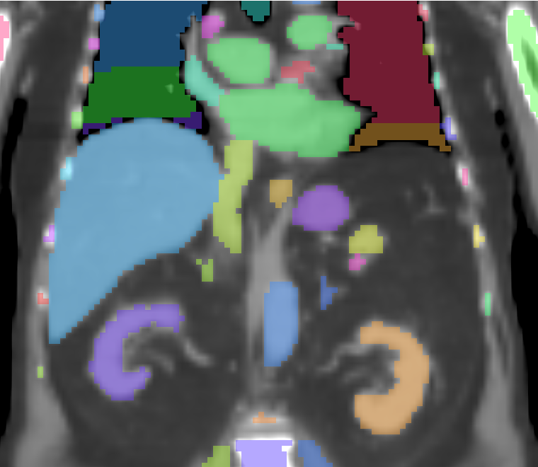
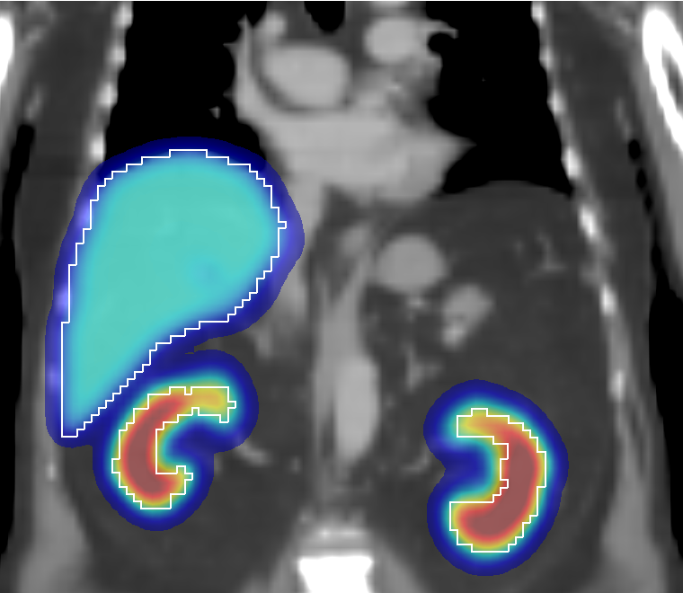
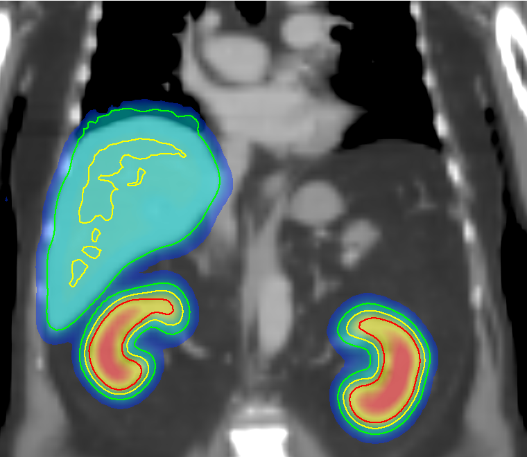

# Viewing the Images with vvv

radot reads and writes plain images (NIfTI, MHD, NRRD) with a JSON sidecar; it has no viewer. To look at the images, use [vvv](https://github.com/dsarrut/vvv), a fast 3D/4D viewer from the same author:

```bash
pip install "open-vvv>=0.8"      # the package is open-vvv, the command is vvv
```

vvv reads the same sidecars as radot: the radot images open with their **units** and the label maps with their **organ names**, without conversion. Look at the images at each step: most wrong doses come from the inputs (segmentation, registration, units), and they show at a glance.

---

## 1. What vvv reads from the radot sidecars

| radot sidecar | vvv shows |
|---|---|
| `"unit": "hu"` | HU |
| `"unit": "bqml"` | Bq/mL |
| `"unit": "bq"` (activity per voxel) | Bq |
| `"unit": "suv"`, `"sul"` | SUV, SUL |
| `"unit": "bqs"`, `"bqsml"` (time-integrated activity) | Bq·s, Bq·s/mL |
| `"unit": "gy"` | Gy, and the **Dose tool** (isodoses, DVH) |
| `"unit": "gy/h"`, `"gy/s"` (dose rate) | Gy/h, Gy/s, and the Dose tool |
| label map sidecar `{"1": "Liver", ...}` (`radot segment`) | the ROI names |

vvv only changes its own keys (`unit`, labels) when it saves: the radot keys (radionuclide, activity, dates, weight, ...) are kept.

!!! note "vvv version"
    The units `bq` (per voxel), `bqs`, `bqsml`, `gy/h`, `gy/s`, and the Dose tool on dose rates, need vvv 0.8.0 or later ([vvv issue 53](https://github.com/dsarrut/vvv/issues/53)). Older versions show `bq` as Bq/mL, the others as raw text, and turns a file named `dose_rate` into Gy.

---

## 2. Use cases

The syntax: images separated by spaces open side by side; `base,overlay,colormap` fuses an overlay on a base image; `+ labels.nii.gz` adds a label map as ROIs; `-s` synchronises the viewers (slice, pan, zoom). See the [vvv command line](https://github.com/dsarrut/vvv/blob/main/user_docs/doc_03_command_line.md).

### Check a segmentation

```bash
radot segment ct.nii.gz -o labels.nii.gz
vvv ct.nii.gz + labels.nii.gz
```



The ROIs have the TG-263 names of `labels.json`. Look for missing or truncated organs (field of view), and for organs that leak into their neighbours: the dose is a mean over the ROI, so a wrong ROI is a wrong dose.

### Check the SPECT/CT registration

```bash
vvv ct.nii.gz,spect.nii.gz,jet + labels.nii.gz
```



The activity must be inside the body and on the organs. Do it at least when [`radot check`](1c_check.md) warns on `geom.activity_in_body` or `geom.organ_shift`: the message gives the organ and the direction of the shift (e.g. "Kidney_L 20 mm anterior"). radot does not register images: fix the registration with your own tools, then recompute.

### Look at a dose map and its DVH

```bash
radot dose spect.nii.gz -l labels.nii.gz --ct ct.nii.gz -m ldm --isotope Lu177 -o dose.nii.gz
vvv ct.nii.gz,dose.nii.gz + labels.nii.gz
```



The dose image (`gy`) turns on the vvv **Dose** tool: isodose lines or colorwash, normalisation (max, prescription, ROI mean), and the dose-volume histogram of each ROI (see [vvv Dose & DVH](https://github.com/dsarrut/vvv/blob/main/user_docs/doc_16_dose.md)). The same works on a dose-rate image (`--dose-rate`, Gy/h) and on an OpenGATE dose-rate map with a `gy/s` sidecar.

The isodose levels are percentages of a reference dose: set the reference (e.g. **Prescription** 10 Gy, then 60 %, 40 %, 20 % are 6, 4, 2 Gy) to draw lines at absolute doses.

The vvv ROI mean is the mean of the voxel values; the radot ROI mean (`dose_rois.json`) is weighted by the voxel masses from the CT density. They differ slightly where the density varies (lung, bone edges).

### Several time points

```bash
vvv spect_d1.nii.gz spect_d4.nii.gz spect_d7.nii.gz -s
```

Side by side and synchronised: check that the organs are at the same place at each time point. With one segmentation for all the time points (see [Jackson 2013](6b_dose_organ.md#jackson-2013-jackson2013)), the images must be registered beforehand.

### Compare two dose maps

```bash
vvv dose_ldm.nii.gz gate_dose_rate.mhd -s
```

For example the radot LDM and an OpenGATE map (see [external dose-rate map](6c_dose_voxel.md#2-external-dose-rate-map-monte-carlo)): the photons and the cross-doses appear outside the uptake organs in the Monte Carlo map only. The OpenGATE map is per simulated activity (e.g. Gy/s for 1 MBq): use the **Scale** of the Dose tool, or the max normalisation, to compare the shapes.

The images on this page: p142 CT and TotalSegmentator labels from the radot OpenGATE validation data ([Zenodo](https://doi.org/10.5281/zenodo.23809698), CC-BY 4.0), with a synthetic Lu-177 SPECT (uptake in the liver, kidneys and spleen) and its radot LDM dose; coronal slices.

---

## 3. Trap: vvv transforms are ignored by radot

When you register an image by hand in vvv and save the transform, vvv writes it next to the image (`spect.tfm`, a sidecar) and **applies it at every load**. radot (like any other tool) reads the voxels of `spect.nii.gz` and ignores `spect.tfm`.

So two images can look registered in vvv and not be registered for radot: the doses are then computed on the unregistered images, and `radot check` reports the shift. To use a vvv registration in radot, put the transform in the voxels: **Resample Image** in the vvv Registration panel, save the image, and give that image to radot.
